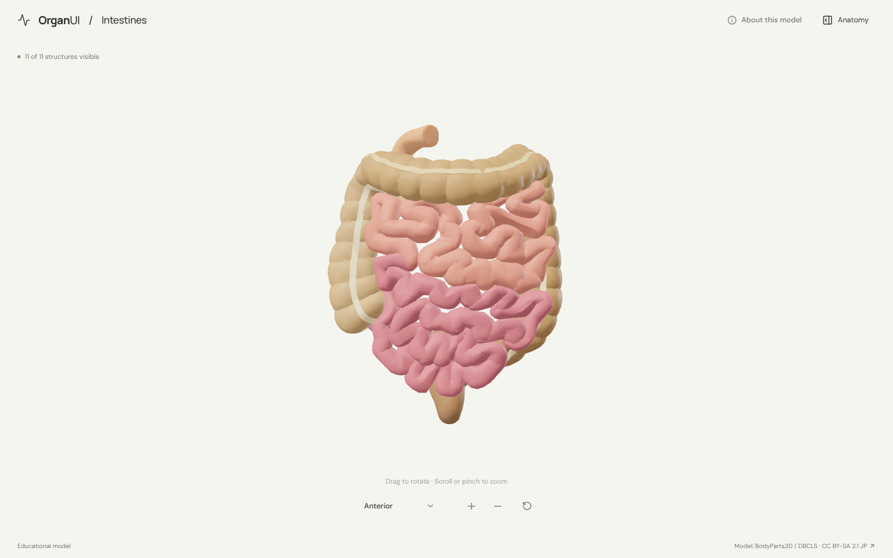
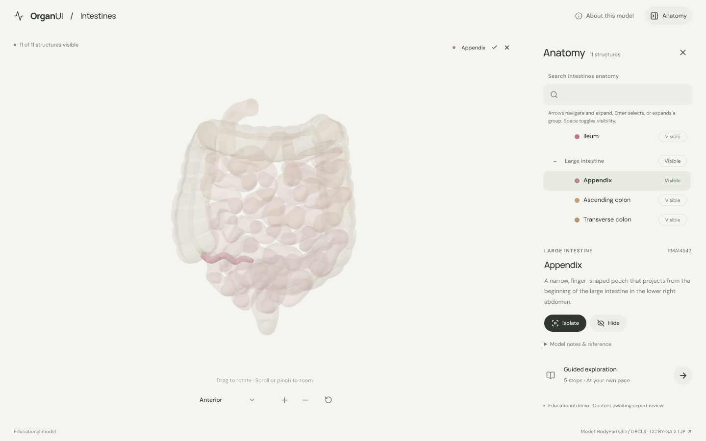
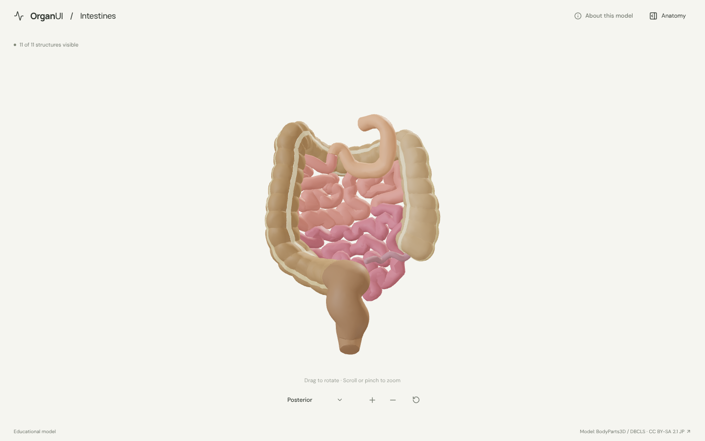
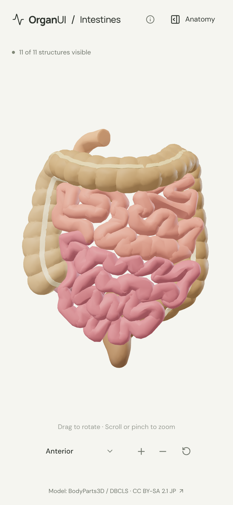

# OrganUI Intestines

A minimal, standalone, open-source explorer of the human small and large intestine, built with React, TypeScript, Three.js, React Three Fiber, Vite, and Bun.

**Status:** working local demo. Eleven selectable structures, a real bundled model, responsive layouts, and verified desktop/mobile interactions. Public deployment and clinical anatomy review have not been completed.



## Run locally

Install [Bun](https://bun.sh/) **1.4.2 or newer**, then:

```sh
git clone https://github.com/organui/intestines-3d.git
cd intestines-3d
bun install --frozen-lockfile
bun run dev
```

Open **http://127.0.0.1:5173**. No environment variables, accounts, sibling repositories, or model downloads are needed after dependency installation. The ready-to-use 2.4 MB GLB is in `public/models/`.

```sh
bun run typecheck       # TypeScript checks, including conversion scripts
bun run test            # Selection emphasis, picking, and the anatomy-tree adapter
bun run verify:model    # Check the GLB hash, source IDs, and valid geometry
bun run build           # Typecheck and create dist/
bun run preview         # Serve the production build at http://127.0.0.1:4173
bun run format:check    # Check formatting
```

## Explore

The explorer follows the shared OrganUI explorer behaviour, with [heart-3d](https://github.com/organui/heart-3d) as the reference:

- The intestines open in an anterior view that fills the stage. Drag to rotate; scroll or pinch to zoom.
- The camera toolbar holds the view menu (anterior, posterior, left lateral), zoom in, zoom out, and reset. Manual rotation changes the label to **Custom view**; clicking a structure does not.
- Select a structure in 3D or in the anatomy tree. The selection glows in its own colour and everything else is ghosted, so a structure behind others (the duodenum behind the transverse colon, the appendix behind the ileum) stays visible. A chip shows the selection; its name opens the panel.
- The **Anatomy** panel is closed by default. It holds the OrganUI registry `anatomy-tree` (search, groups, per-structure visibility), the selected structure's details with **Isolate** and **Hide**, and a five-stop guided exploration. Opening the panel moves focus into it; Escape or close returns focus to the toggle.
- **Reset** restores the anterior camera, visibility, selection, tree search, and tour.
- Loading shows byte progress. A missing model or unavailable WebGL shows recovery controls while the anatomy panel stays usable.

<details>
<summary>More screenshots</summary>







</details>

## Model, credits, and review status

> BodyParts3D / Anatomography, © The Database Center for Life Science (DBCLS). Licensed under [CC BY-SA 2.1 Japan](https://creativecommons.org/licenses/by-sa/2.1/jp/deed.en). Adapted by OrganUI.

The model is a subset of **BodyParts3D / Anatomography 4.3**: 64 original meshes, each checked against the SHA-256 in a pinned public mirror and against the official 4.3 concept table. The model data, and images of it such as the screenshots, are under **CC BY-SA 2.1 Japan**, separately from this repository's **MIT** code license. See [model provenance](docs/MODEL_PROVENANCE.md), the [runtime license notice](public/models/LICENSE.txt), and the [manifest](public/models/manifest.json).

| Group | Structures |
| --- | --- |
| Small intestine | Duodenum, jejunum (23 loop meshes), ileum (32 loop meshes) |
| Large intestine | Appendix, ascending colon, transverse colon, descending colon, rectum |
| Taeniae coli | Mesocolic, omental, and free taenia |

Known limitations:

- The source has **no separate cecum or sigmoid colon**; the ends of the ascending and descending colon meshes stand in for them. Nothing was cut or invented to fake those boundaries.
- The mesentery, mesocolon, blood vessels, stomach, anal canal, and pelvic floor are omitted. Vessel and organ junctions are open ends.
- The jejunum/ileum boundary is the source's; in the body the transition is gradual.
- This is a simplified adult male reference model, not a patient-specific one. Colours are illustrative.
- Descriptions are short summaries written for this demo, with links to [NIDDK](https://www.niddk.nih.gov/health-information/digestive-diseases/digestive-system-how-it-works) and [NCI SEER Training](https://training.seer.cancer.gov/anatomy/digestive/regions/intestine.html). **Expert anatomical review is pending.** This is an educational demonstration, not a diagnostic or clinical tool.
- Browser checks used desktop Chromium and mobile viewport sizes with software WebGL, not physical devices or a screen reader.

## Reproduce the model

```sh
bun run prepare:model
bun run verify:model
```

This downloads the 64 pinned OBJ files (about 6 MB) into ignored `.asset-cache/`, verifies every SHA-256 and OBJ header, and writes the GLB and manifest. Regeneration is byte-identical.

## Implementation

- `src/anatomy.ts`: structures, source concepts, text, and guided stops.
- `src/anatomy-adapter.ts`: maps structures to the registry anatomy tree.
- `src/components/ui/anatomy-tree.tsx`: OrganUI registry component installed with the shadcn CLI; not hand-edited ([details](docs/REGISTRY_INTEGRATION.md)).
- `src/framing.ts`: shared framing rule, identical in every OrganUI explorer.
- `src/App.tsx`, `src/Viewer.tsx`, `src/ViewMenu.tsx`, `src/SceneCanvas.tsx`, `src/picking.ts`: interface, renderer, and picking, shared with heart-3d.
- `scripts/`: pinned inputs, reproducible conversion, and runtime validation.

See [verification](docs/VERIFICATION.md).

## License

Original application code: [MIT](LICENSE). The anatomy model, derived model images, fonts, and icons keep their separately documented licenses.

Part of [OrganUI](https://github.com/organui).
